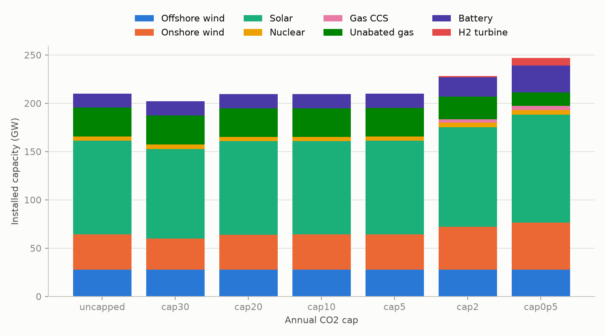
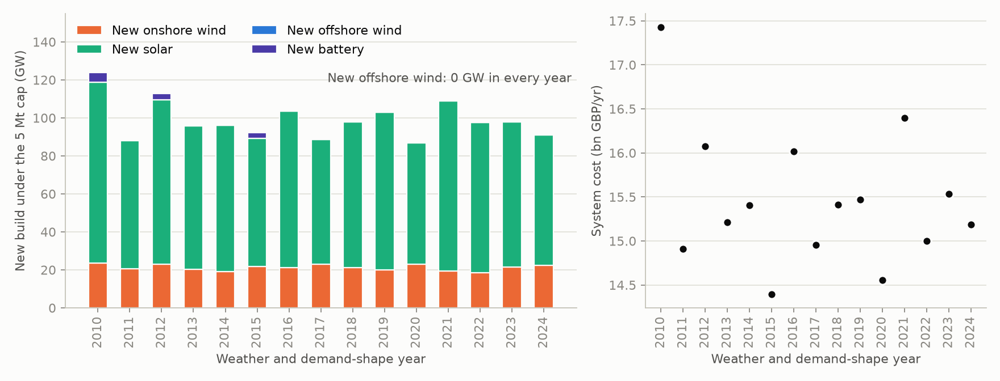

# gb-2035-pypsa

[](https://github.com/younis-y/gb-2035-pypsa/actions/workflows/ci.yml)
[](https://github.com/younis-y/gb-2035-pypsa/actions/workflows/docker.yml)
[](LICENSE)
[](.python-version)

Least-cost GB power system in 2035 under tightening carbon caps, with a Teesside industrial
hydrogen node. PyPSA + HiGHS, 20 transmission zones, a full year at 3-hourly resolution:
15 solved scenarios on 2019 weather, and the 5 MtCO2 case re-solved on every weather
year from 2010 to 2024.

**The answer this model gives.** At DESNZ 2035 medium costs, the cheapest GB system that
meets a 5 MtCO2 cap costs 15.5 bn GBP/yr and is built on onshore wind and solar, not on new
offshore wind: 36.3 GW of onshore wind and 97.0 GW of solar against 27.9 GW of offshore, and
not one megawatt of new offshore is built at any cap in the sweep. NESO's FES 2025 Holistic
Transition reaches 86.1 GW of offshore by 2035. The model climbs into onshore zones costing
about 52 GBP/MWh before it will buy a megawatt of offshore at 63. Tightening the cap from 30
to 2 MtCO2 adds 2.1 bn GBP/yr and lifts the shadow carbon price from 0 to 910 GBP/t, and the
Teesside hydrogen demand is met by blue hydrogen at every cap, never by electrolysis.

**How far that holds.**

- **Weather.** Re-solved on all 15 weather years from 2010 to 2024, the 5 MtCO2 system
  builds no new offshore wind in any of them; its cost runs from 14.4 to 17.4 bn
  GBP/yr and its new solar from 64 to 95 GW
  ([`results_weather_years/`](results_weather_years/)).
- **Offshore's cost.** At each year's solved prices, offshore's capex would have to fall by
  32 to 55 percent before its first megawatt paid, least in 2010, the least windy
  year. Re-solving 2019 with offshore capex 36 percent lower builds none; 49 percent lower
  builds 4.0 GW.
- **Planning.** Holding onshore wind and solar to their FES totals, the stand-in for the
  planning limits the model lacks, costs 0.4 bn GBP/yr more and still builds no offshore:
  imports more than double instead. Pricing imports at 100 GBP/MWh as well brings in only
  0.6 GW of offshore, beside 3.0 GW of gas CCS.
- **Resolution and solver.** An hourly re-solve moves cost by 0.4 percent, and re-solving
  `cap5` from scratch reproduces its cost to the penny.

The working for each is in [`docs/findings.md`](docs/findings.md#robustness).

## Results

The table is generated by `gb2035 report --update-readme` from
[`results/summary.csv`](results/summary.csv); each run's commit, solver, versions and input
fingerprint are in its `run_meta.json`. `uncapped`'s total includes carbon payments at
55 GBP/t, a transfer rather than a resource cost, so it is not comparable with the capped
rows; blue hydrogen has no capex, so only its TWh are meaningful.

<!-- summary:start -->
| Scenario | CO2 (Mt) | System cost (bn GBP/yr) | Shadow carbon price (GBP/t) | Onshore (GW) | Offshore (GW) | Solar (GW) | Battery (GW) | Electrolysis (GW) | Green H2 (TWh) | Blue H2 (TWh) |
|---|---|---|---|---|---|---|---|---|---|---|
| uncapped | 4.6 | 15.7 | 0 | 36 | 28 | 97 | 15 | 0.0 | 0.0 | 5.0 |
| cap30 | 28.2 | 14.8 | 0 | 32 | 28 | 93 | 15 | 0.0 | 0.0 | 5.0 |
| cap20 | 20.0 | 15.0 | 33 | 36 | 28 | 97 | 15 | 0.0 | 0.0 | 5.0 |
| cap10 | 10.0 | 15.3 | 33 | 36 | 28 | 97 | 15 | 0.0 | 0.0 | 5.0 |
| cap5 | 5.0 | 15.5 | 52 | 36 | 28 | 97 | 15 | 0.0 | 0.0 | 5.0 |
| cap2 | 2.0 | 16.8 | 910 | 44 | 28 | 103 | 20 | 0.0 | 0.0 | 6.5 |
| cap5_no_h2 | 5.0 | 15.1 | 52 | 36 | 28 | 97 | 15 | 0.0 | 0.0 | 0.0 |
| cap5_ee_demand | 5.0 | 16.6 | 226 | 42 | 28 | 105 | 17 | 0.0 | 0.0 | 1.3 |
| cap5_tx_expansion | 5.0 | 15.5 | 52 | 36 | 28 | 97 | 15 | 0.0 | 0.0 | 5.0 |
| cap5_import_100 | 5.0 | 17.4 | 128 | 44 | 28 | 99 | 15 | 0.0 | 0.0 | 5.0 |
| cap5_steel | 5.0 | 15.6 | 52 | 37 | 28 | 97 | 15 | 0.0 | 0.0 | 5.0 |
| cap5_fes_ceiling | 5.0 | 15.9 | 293 | 38 | 28 | 62 | 15 | 0.0 | 0.0 | 5.0 |
| cap5_fes_ceiling_import_100 | 5.0 | 18.2 | 128 | 38 | 28 | 62 | 15 | 0.0 | 0.0 | 5.0 |
| cap5_offwind_capex64 | 5.0 | 15.5 | 52 | 36 | 28 | 97 | 15 | 0.0 | 0.0 | 5.0 |
| cap5_offwind_capex51 | 5.0 | 15.4 | 33 | 32 | 32 | 93 | 15 | 0.0 | 0.0 | 5.0 |
<!-- summary:end -->





More figures (cost and shadow price, the cap2 build against FES, storage, Teesside
hydrogen) are in [`docs/figures/`](docs/figures/).

## Findings

Each line below is argued in full, with the file behind every number, in
[`docs/findings.md`](docs/findings.md).

1. **Cost rises gently to a 5 Mt cap, then steeply:** 14.8 to 15.5 bn GBP/yr from 30 to
   5 MtCO2, then 16.8 at 2 Mt, where the shadow price jumps from 52 to 910 GBP/t.
2. **The tightest converged build is solar- and onshore-heavy:** at 2 Mt, 103.4 GW of solar
   and 44.0 GW of onshore wind against FES's 61.8 and 38.4, and 68 percent less offshore.
3. **Offshore loses on cost ranking, not on room.** No cap in the sweep builds greenfield
   offshore; it enters only with its capex cut by about half (4.0 GW) or with onshore, solar
   and imports all held back (0.6 GW). Zonal land-area caps bind, but the model prefers worse
   onshore zones to the best offshore site.
4. **Blue hydrogen wins Teesside outright:** electrolysis is 0.0 GW everywhere, and storage
   only appears at 2 Mt.
5. **The Teesside node costs 356 m GBP/yr,** which its hydrogen price decomposes exactly.
6. **Imports at 100 GBP/MWh cost 1.9 bn GBP/yr** and turn GB from net importer to exporter.
7. **Transmission expansion is worth nothing here,** although Scotland to England binds in
   3.5 percent of hours.

## How it is tested

A model repository has two things to test: the code, and the results it has committed. Both
run on every pull request.

| Tier | Tests | What it pins |
|---|---|---|
| `tests/unit` | 183 | data builders, config validation, network construction (component counts, costs, caps, CCS siting, the FES ceiling, weather-year inputs, fingerprints), the report, the app's data layer, the CI and Docker workflow files, docs links |
| `tests/integration` | 21 | real HiGHS solves of the one-week CI scenario: optimal status, AC energy balance, a binding CO2 cap with a positive dual, additive costs, and the objective against a stored value to 0.5 percent. The breakeven is tested as a price: cutting offshore capex 15 percent past the shortfall its market value implies builds Dogger Bank, and 15 percent short builds nothing |
| `tests/e2e` | 7 | the CLI end to end: `run`, `report`, `extract` and their failure messages |
| `tests/architecture` | 5 | the app never imports the solver stack or the model package, even transitively; core modules take config as arguments, never from globals or the environment; every assumption has a source |
| `tests/results` | 266 | eight checks on each of the 31 committed runs (tables present; AC energy equal to the demand the model was given; CO2 under the cap, with a priced cap binding; cost rows adding up; every unit earning what optimality requires at the run's own prices; the solver and libraries now configured; a clean commit on any re-extraction; the input fingerprint equal to what the current code builds), then each `summary.csv` against its runs, the README table against the results, and the headline numbers in the README and `docs/findings.md` recomputed from committed files |

The last check is the one that keeps a modelling repo honest. Every run records a hash of the
unsolved network in `run_meta.json`, and the test rebuilds every committed scenario and
compares. Change a cost, a profile, a config value or the network-building code so that any
scenario builds a different LP, and CI fails until that scenario is re-solved (raising the gas
price by 1 GBP/MWh fails all of them). How each run was solved sits outside that hash, so the
solver it records is checked against config and its PyPSA and HiGHS against `uv.lock`. The 12
runs solved before fingerprints existed were fingerprinted afterwards by rebuilding each
network at its own solve commit; every one matched the current code. The same checks found a
real bug while this was built: leap weather years served 0.27 percent less than the FES demand
total, so the four leap years failed the energy balance and were fixed and re-solved.

Two workflows run them. [`ci.yml`](.github/workflows/ci.yml) installs from the lockfile
(`uv sync --locked`), then runs ruff, mypy in strict mode, every test tier, the committed
results as their own named step, and a Snakemake dry run of the whole pipeline.
[`docker.yml`](.github/workflows/docker.yml) lints the Dockerfile with hadolint, builds the
image, checks the app's health endpoint and solves the CI week inside the container, and pushes
to GHCR from `main` only.

The CI week is solved with simplex, not the PDLP used for the published sweep, because PDLP's
termination status at that horizon differed by platform (optimal on macOS ARM64, "unknown" on
Linux x86_64 for the same inputs). Simplex is deterministic, so the stored objective can be
checked to 0.5 percent.

## Run it

```bash
uv sync --all-extras --group dev
uv run pytest --runslow                                    # every tier, about 5 minutes
uv run gb2035 run --scenario test                          # the CI week, about 30 seconds
uv run gb2035 run --scenario cap5 --resolution-hours 3     # one published scenario, minutes
uv run gb2035 report                                       # results/summary.csv and figures
```

Derived inputs are committed, so a fresh clone solves offline. `uv run snakemake --snakefile
workflow/Snakefile --cores 4 all` rebuilds the published set from the raw sources: it fetches
and checks every pinned input but the ERA5 cutouts (`data/manifest.json`), rebuilds the derived
tables but the wind and solar profiles, and re-solves every scenario with committed results at
3-hourly resolution, which takes many hours. Regenerating a year's profiles needs its 765 MB
cutout and the `profiles` extra (`gb2035 build-profiles --weather-year <year>`).

## Method

One linear program sizes capacity and dispatches it together, across 20 GB transmission zones
(PyPSA-GB's zonal topology, inherited from UK-Calliope) plus a hydrogen bus at Teesside,
joined by 31 fixed transport-model links. Every technology splits in two: a brownfield unit
fixed at the REPD or DUKES capacity already built or under construction and charged fixed O&M
only, and a greenfield unit extendable from zero at annuitised capex plus fixed O&M. A single
PyPSA `GlobalConstraint` caps annual CO2 from gas, gas CCS and blue hydrogen, and its dual is
the shadow carbon price. Costs are PyPSA technology-data v0.15.0 for 2035 at 0.85 GBP/EUR,
with DESNZ Electricity Generation Costs 2025 overriding the eight technologies it covers.
Snapshots are the weather year's own timestamps standing for 2035, with demand rescaled to
a FES 2035 pathway total.

Full detail, including the weather years, the planning ceiling, the breakeven and the
provenance checks: [`docs/methodology.md`](docs/methodology.md). Every sourced number:
[`docs/assumptions.md`](docs/assumptions.md).

## Resolution and solver

The published runs take every third hour of the year, 2,920 snapshots each weighted 3 (2,928
weighted 2.99 in leap years). An
hourly re-solve of `cap5` ([`results_hourly/cap5/`](results_hourly/cap5/)) puts total cost
0.4 percent higher, leaves the shadow carbon price at 52 GBP/t and shifts about 1 GW between
new onshore wind and new solar; new offshore, electrolysis and hydrogen storage stay at zero.

The solver is HiGHS's first-order PDLP at 1e-5 feasibility tolerances, because simplex does
not finish a full year in usable time. HiGHS ships two PDLP implementations: most runs use
cuPDLP-C (`pdlp`), and `cap5_ee_demand` and `cap5_wy2010` use HiGHS's own (`hipdlp`), each
after cuPDLP-C ended at status "unknown" on it. Each run records its solver in
`run_meta.json`, and a test checks it against `config/scenarios.yaml`. PDLP meets constraints
to within tolerance rather than at a vertex, so its duals are less precise than simplex's, and
cost differences below about 0.1 m GBP/yr on a 15.5 bn base are inside that tolerance.

The 0.5 MtCO2 cap (`cap0p5`) is not in the results: cuPDLP-C crawled for 1 hour 50 minutes
without converging, and HiGHS's own PDLP stopped at a four-hour limit. That cap leaves about
0.4 Mt for unabated gas once blue hydrogen's 0.1 Mt is paid for, the near-vertical part of
the abatement curve, where first-order methods crawl. `config/scenarios.yaml` gives it
interior point with crossover for the next attempt, and `cap2` remains the tightest converged
cap.

## What this model does not claim

Out of scope by design: multi-year pathways, unit commitment, AC power flow, reserve and
inertia products, distribution networks, demand-side response beyond electrolysis and
storage, biomass and BECCS, Northern Ireland, and endogenous interconnector expansion.

The limitations that bear on the headline:

- **Planning and land use are absent** except as the FES-ceiling sensitivity above; the
  greenfield caps split national limits by land area, not by consentable sites.
- **Interconnectors are price-takers:** 65 GBP/MWh in, 45 out, up to 19.4 GW, with no
  foreign market to clear against.
- **Each weather year is solved alone,** with perfect foresight: no year has to survive on
  another year's build, and there is no adequacy margin or reserve.
- **The demand shape is the weather year's own, rescaled.** Electrified heat and transport
  would make 2035 more winter-peaking: the rescaled 2019 shape peaks at about 71 GW against
  FES Holistic Transition's 74.3 GW. That favours wind over solar, so the solar build is if
  anything flattered.
- **Offshore profiles carry no wake losses,** which flatters offshore (Dogger Bank's 2019
  capacity factor is 0.62). Separately, the GB cutout stops at 1.75 degrees east, so Dogger
  Bank and Hornsea are represented by their covered western parts and East Anglia by the
  cells west of it; which way that biases offshore is not measured.

The full list, with how each was measured, is in
[`docs/methodology.md`](docs/methodology.md#known-simplifications).

## Front end

A read-only Streamlit explorer over the committed results, five views, no solving
(`uv run gb2035 app`; what each view reads is in [`docs/app.md`](docs/app.md)).

## Run with Docker

The published image carries the app, the committed results and the `gb2035` CLI; CI builds,
lints and smoke-tests it, including a solve inside the container, and pushes from `main`
only.

```bash
docker run -p 8501:8501 ghcr.io/younis-y/gb-2035-pypsa:latest
docker run --rm ghcr.io/younis-y/gb-2035-pypsa:latest gb2035 run --scenario test --results-dir /tmp/results
```

## Data and licences

Every external input is pinned in [`data/manifest.json`](data/manifest.json) with its URL,
SHA-256 checksum and licence; `gb2035 retrieve` downloads and verifies each one, and what is
derived from each is in [`docs/data_sources.md`](docs/data_sources.md). Inputs are MIT
(PyPSA-GB), Open Government Licence v3 (DESNZ REPD and Electricity Generation Costs 2025),
the NESO Open Data Licence (historic demand, FES 2025 Data Workbook) and CC-BY-4.0 (the
Zenodo ERA5 cutouts, and technology-data's data; its code is GPL-3.0). Renewables.ninja was
not used because its GB files are CC BY-NC. This repository's own code is MIT
([`LICENSE`](LICENSE)).

## Built on

- [PyPSA](https://github.com/PyPSA/PyPSA) for the formulation, and
  [HiGHS](https://highs.dev/) for the solve.
- [PyPSA-GB](https://github.com/andrewlyden/PyPSA-GB) for the 20-zone topology, inter-zone
  link capacities and power station locations, which it inherits in turn from
  [UK-Calliope](https://github.com/calliope-project/uk-calliope).
- [PyPSA technology-data](https://github.com/PyPSA/technology-data) v0.15.0 for 2035 costs.
- NESO's [Future Energy Scenarios 2025](https://www.neso.energy/publications/future-energy-scenarios-fes)
  and historic demand data, and ETYS 2025 for boundary capabilities.
- DESNZ for the Renewable Energy Planning Database and Electricity Generation Costs 2025.
- The [Zenodo ERA5 cutouts for GB](https://zenodo.org/records/18325225) (CC-BY-4.0), run
  through [atlite](https://github.com/PyPSA/atlite) for the wind and solar profiles.
- The author's earlier repositories: `gb-weather-to-price-forecasting` (the battery
  arbitrage LP, its round-trip efficiency and wear cost, and the REPD capacity weighting),
  `heat-pump-peak-demand-modelling` and `uk-onshore-wind-siting` (the onshore siting caps).
- Systemiq's Steel-IQ for the engineering conventions (frozen configuration, the manifest
  with checksums, the test tiering and architecture test) and for the steel scenario's route
  vocabulary: [`docs/steel_iq_link.md`](docs/steel_iq_link.md).

Built with AI assistance (Claude Code): most commits carry its co-author trailer, and the
plans and specs it worked from are kept in [`docs/superpowers/`](docs/superpowers/).
