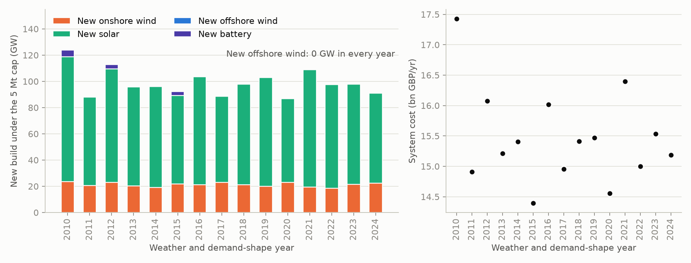

# Findings in full

The README states each finding in a line; this page carries the working behind it, with the
committed file every number comes from. All of it is the published 3-hourly sweep on 2019
weather; how far it holds on other weather years and under planning limits is in
[Robustness](#robustness).

1. **Cost rises gently to a 5 Mt cap, then steeply.** System cost runs 14.8, 15.0, 15.3,
   15.5, 16.8 and 18.9 bn GBP/yr across the 30, 20, 10, 5, 2 and 0.5 MtCO2 caps, and the shadow
   carbon price runs 0, 33, 33, 52, 910 and 2,332 GBP/t
   ([`results/summary.csv`](../results/summary.csv)). The 30 Mt cap is slack, so its dual is
   zero: the cost-minimising build already emits only 28.2 Mt. (The `uncapped` row's 4.6 Mt
   is not that unconstrained optimum either: `uncapped` drops the cap but prices carbon at
   the UK ETS's 55 GBP/t, which buys most of the abatement a cap would have forced, and those
   payments are a transfer rather than a resource cost, so its 15.7 bn total is not
   comparable with the capped rows.) The 33 GBP/t plateau across the 20
   and 10 Mt caps is a structural breakpoint, the price at which an existing CCGT
   (24 GBP/MWh thermal over 0.5 efficiency plus 5 GBP/MWh variable O&M = 53 GBP/MWh, at
   0.368 tCO2/MWh) becomes dearer than a 65 GBP/MWh import: (65 - 53) / 0.368 = 32.6 GBP/t.
   Below 10 Mt that switch is exhausted and the price climbs to what new abatement costs:
   52 GBP/t at 5 Mt, then 910 GBP/t at 2 Mt, where the model has to build gas CCS and
   hydrogen storage rather than simply redispatch, and 2,332 GBP/t at 0.5 Mt, where it turns to
   electrolysis. The last step, from 2 to 0.5 Mt, costs 2.1 bn GBP/yr, as much as the whole way
   from 30 to 2.

2. **At the tightest cap the build is solar- and onshore-heavy, with three times FES's
   hydrogen generation and about half its gas CCS.** `cap0p5` holds 48.5 GW onshore wind,
   112.1 GW solar, 27.9 GW offshore wind, 27.6 GW battery, 7.9 GW of hydrogen turbines, 4.4 GW
   gas CCS and 14.1 GW unabated gas, which runs for only 0.9 TWh
   ([`results/cap0p5/summary_row.csv`](../results/cap0p5/summary_row.csv) and
   [`results/cap0p5/energy.csv`](../results/cap0p5/energy.csv)). The gas CCS is spread across
   all six zones a CO2 pipeline could reach, 0.2 to 1.1 GW in each of Z5, Z7, Z8, Z9, Z13 and
   Z16 ([`config/ccs_zones.yaml`](../config/ccs_zones.yaml) and
   [`results/cap0p5/capacities.csv`](../results/cap0p5/capacities.csv)). FES 2025 Holistic
   Transition for 2035 has 38.4 GW onshore, 61.8 GW solar, 86.1 GW offshore, 29.8 GW battery
   plus 10.5 GW of long-duration storage, 2.6 GW of hydrogen generation, 8.1 GW gas CCUS and
   14.7 GW unabated gas
   ([`data/derived/fes2025_gb_2035.csv`](../data/derived/fes2025_gb_2035.csv)). The model buys
   81 percent more solar and 26 percent more onshore wind than FES, and 68 percent less
   offshore wind.

3. **Offshore wind loses on cost ranking, not on a shortage of room.** No greenfield offshore
   is built at any cap or in any of the published sensitivities; the 27.9 GW reported
   throughout is the REPD operational-plus-under-construction fleet
   ([`results/summary.csv`](../results/summary.csv), `offwind_new_gw`). It is built only in the
   two robustness runs that set out to force it, 4.0 GW in `cap5_offwind_capex51` and 0.6 GW
   in `cap5_fes_ceiling_import_100` ([Robustness](#robustness)). At
   the committed 2035 costs, greenfield offshore annuitises to 345,807 GBP/MW-yr against
   onshore's 137,259 and solar's 41,392
   ([`data/derived/costs_2035_gb.csv`](../data/derived/costs_2035_gb.csv)); DESNZ folds an
   86,700 GBP/MW-yr connection charge into offshore's fixed O&M on its own, about two fifths
   of the 208,500 GBP/MW-yr annuitised gap to onshore.

   On a levelised basis, annuitised cost divided by mean 2019 capacity factor times 8,760,
   plus variable O&M, from
   [`data/derived/costs_2035_gb.csv`](../data/derived/costs_2035_gb.csv) and
   [`data/derived/cf_2019_zonal.parquet`](../data/derived/cf_2019_zonal.parquet): offshore runs
   63.3 GBP/MWh at Dogger Bank, 65.5 at Hornsea and 74.7 at East Anglia. Mainland onshore
   (the fifteen land zones, excluding Z1_1 to Z1_4 and Z4 where ERA5 inflates the capacity
   factor) runs 41.7 at best (Z17), 47.8 at the median and 63.8 at worst (Z3); solar across
   all twenty zones runs 34.5 at best (Z15), 41.8 at the median and 49.3 at worst (Z1_4).
   Those ranges overlap: the worst mainland onshore zone (Z3, 63.8) is dearer than the best
   offshore site (Dogger Bank, 63.3). What decides it is where the model stops, not where the
   ranges end. At `cap2`, and again at `cap0p5`, the dearest zone it actually builds onshore
   in is Z1_4 at 52.3 GBP/MWh, and the dearest mainland one is Z13 at 48.9, both still clear of
   Dogger Bank's 63.3, so offshore is never the next megawatt worth buying. Z1_4 is one of the
   zones where ERA5 inflates the capacity factor, so its true cost is higher than 52.3 and this
   margin is the optimistic reading of it.

   The caps do bind, but zonally rather than nationally. `config/renewable_caps.yaml` splits
   each national greenfield cap across the twenty land zones by land area, and the extendable
   unit in a zone cannot exceed its share. At `cap5` the split is exhausted in 8 of 20 onshore
   zones and 9 of 20 solar zones; at `cap2`, in 10 and 11; at `cap0p5`, in 11 and 13 (a zone
   counts as binding when its greenfield `p_nom_opt` equals its
   national-cap-times-land-area-share to the megawatt in each run's `capacities.csv`). The
   national totals stay well short even so: `cap0p5` builds 32.2 GW of new onshore against
   the 60 GW greenfield cap and 97.9 GW of new solar against 150 GW
   ([`results/cap0p5/summary_row.csv`](../results/cap0p5/summary_row.csv), `onwind_new_gw` and
   `solar_new_gw`). So the land-area split exhausts the windiest and sunniest zones first and
   pushes the model into progressively worse ones, and it still prefers those to offshore.
   FES's 86.1 GW reflects planning consent, land use and public acceptability for onshore and
   solar, none of which this model represents.

4. **Blue hydrogen wins Teesside down to 2 Mt; at 0.5 Mt electrolysis takes over.** Blue
   hydrogen supplies the whole industrial demand in every scenario that has one but `cap0p5`,
   5.0 TWh in the Holistic Transition scenarios and 1.3 TWh in `cap5_ee_demand`, whose Electric
   Engagement pathway assumes far less industrial hydrogen. Electrolysis is built only at
   0.5 Mt, where 2.5 GW running at 65 percent utilisation makes 9.6 TWh of green hydrogen and
   blue falls to 1.5 TWh ([`results/cap0p5/hydrogen.csv`](../results/cap0p5/hydrogen.csv)): at
   a 2,332 GBP/t shadow price, blue's residual 0.02 tCO2/MWh adds about 47 GBP/MWh to its 70.
   Across the cap sweep batteries stay at the existing 14.7 GW until the 2 Mt cap adds 5.5 GW
   of new build and the 0.5 Mt cap 12.9 GW (the only other scenario that builds any is
   `cap5_ee_demand`, at 2.7 GW). Hydrogen storage first appears at 2 Mt, a 92.3 GWh store and a
   1.1 GW hydrogen turbine (electrical, `h2_turbine_gw_el` in
   [`results/summary.csv`](../results/summary.csv); the 2.17 GW in
   [`results/cap2/hydrogen.csv`](../results/cap2/hydrogen.csv) is its hydrogen input, not its
   electrical rating) returning 0.8 TWh, filled by blue hydrogen, whose output rises to
   6.5 TWh. At 0.5 Mt the store grows to 1,816 GWh behind 7.9 GW of turbines returning
   3.0 TWh.

5. **The Teesside node costs the power system 356 m GBP/yr, and the price behind it
   decomposes exactly.** `cap5` costs 15.5 bn GBP/yr against `cap5_no_h2`'s 15.1 bn, a
   difference of 356 m GBP/yr ([`results/summary.csv`](../results/summary.csv)). The Teesside H2
   bus clears at 71.0 GBP/MWh ([`results/cap5/duals.csv`](../results/cap5/duals.csv)), which is
   blue hydrogen's 70 GBP/MWh plus its residual 0.02 tCO2/MWh valued at the 52 GBP/t shadow
   price; 71.0 GBP/MWh over 5 TWh is 355 m GBP/yr, the coupling effect to within a million of
   the cost difference. The hydrogen demand does not displace generation, it buys carbon
   budget: unabated gas falls only from 5.0 to 4.9 Mt to make room for blue hydrogen's 0.1 Mt
   ([`results/cap5/emissions.csv`](../results/cap5/emissions.csv)).

6. **Imports at 100 GBP/MWh cost 1.9 bn GBP/yr and flip GB from importer to exporter.**
   `cap5_import_100` costs 17.4 bn GBP/yr against `cap5`'s 15.5, and its shadow carbon price
   more than doubles to 128 GBP/t. Net imports go from +15.1 TWh to -4.4 TWh: imports fall
   from 58.7 to 50.9 TWh while exports rise from 43.7 to 55.2 TWh
   ([`results/cap5/energy.csv`](../results/cap5/energy.csv) and
   [`results/cap5_import_100/energy.csv`](../results/cap5_import_100/energy.csv)). The system
   replaces the lost imports with 7.7 GW more onshore wind and 2.5 GW more solar
   ([`results/summary.csv`](../results/summary.csv)).

7. **Transmission expansion is worth nothing here, even though Scotland to England binds.**
   With every corridor extendable, `cap5_tx_expansion` builds 0 MW of new link and costs
   0.1 m GBP/yr more than `cap5` on a 15.5 bn base, which is inside the solver tolerance
   ([`results/cap5_tx_expansion/flows.csv`](../results/cap5_tx_expansion/flows.csv), every
   `p_nom_new_mw` is zero). That is not because the grid is slack: the two modelled
   Scotland-to-England corridors, Z7-Z2 at 6 GW and Z7-Z6 at 8 GW, total 14.0 GW against
   ETYS 2035's 19.3 GW B6 capability (`etys_2035_b6_capability_gw` in
   [`config/assumptions.yaml`](../config/assumptions.yaml)), and Z7-Z2 runs at 100 percent of
   rating in 3.5 percent of hours at `cap5` and 4.7 percent at `cap2`
   ([`results/cap5/flows.csv`](../results/cap5/flows.csv),
   [`results/cap2/flows.csv`](../results/cap2/flows.csv)). Congesting a corridor for a few
   hundred hours a year is simply cheaper than annuitising more of it.

## Robustness

Everything above is one weather year, at prices and limits the model chose. Four checks ask
how much of it survives when those change.

### Fifteen weather years

`cap5` re-solved on every year the Zenodo GB cutout record holds, 2010 to 2024, each with its
own NESO demand shape rescaled to the same FES total
([`results_weather_years/summary.csv`](../results_weather_years/summary.csv); the capex cut
comes from each run's `breakeven.csv`). No year builds new offshore wind.

| Weather year | System cost (bn GBP/yr) | Shadow carbon price (GBP/t) | New onshore (GW) | New solar (GW) | New battery (GW) | New offshore (GW) | Offshore capex cut to enter (%) |
|---|---|---|---|---|---|---|---|
| 2010 | 17.4 | 390 | 23.5 | 95.4 | 5.0 | 0.0 | 32 |
| 2011 | 14.9 | 59 | 20.6 | 67.6 | 0.0 | 0.0 | 39 |
| 2012 | 16.1 | 285 | 23.1 | 86.4 | 3.2 | 0.0 | 37 |
| 2013 | 15.2 | 52 | 20.4 | 75.3 | 0.0 | 0.0 | 49 |
| 2014 | 15.4 | 53 | 19.1 | 76.9 | 0.0 | 0.0 | 47 |
| 2015 | 14.4 | 33 | 21.6 | 67.7 | 2.9 | 0.0 | 51 |
| 2016 | 16.0 | 185 | 21.3 | 82.2 | 0.4 | 0.0 | 36 |
| 2017 | 15.0 | 52 | 22.9 | 65.7 | 0.0 | 0.0 | 39 |
| 2018 | 15.4 | 52 | 21.1 | 76.7 | 0.0 | 0.0 | 49 |
| 2019 | 15.5 | 52 | 20.0 | 82.9 | 0.0 | 0.0 | 43 |
| 2020 (lockdown demand) | 14.6 | 52 | 23.1 | 63.8 | 0.0 | 0.0 | 55 |
| 2021 (lockdown demand) | 16.4 | 114 | 19.4 | 89.5 | 0.0 | 0.0 | 51 |
| 2022 | 15.0 | 52 | 18.4 | 79.3 | 0.0 | 0.0 | 43 |
| 2023 | 15.5 | 52 | 21.6 | 76.1 | 0.0 | 0.0 | 49 |
| 2024 | 15.2 | 52 | 22.5 | 68.5 | 0.0 | 0.0 | 37 |

The capex cut is how far offshore's annualised capex would have to fall, with its fixed O&M
(which carries DESNZ's 86,700 GBP/MW-yr connection charge) held, before the best offshore
unit's market value at that year's solved prices covered its annual cost. It is the first
megawatt's breakeven, not the cut that would build FES's fleet. The weather moves the mix but not the ranking. System cost spans
14.4 to 17.4 bn GBP/yr, new solar 64 to 95 GW and new onshore wind 18 to 24 GW; the
shadow carbon price sits at about 52 GBP/t in most years, reaches 390 GBP/t in 2010, the least
windy year in the record, and falls to 33 in 2015, the windiest onshore (mean onshore capacity
factors of 0.325 and 0.428 across the zones, the extremes in the 15 years' profiles). 2020 and 2021 carry lockdown demand shapes, which
the rescaling to a FES total does not remove.

### Offshore's breakeven, checked by re-solving

At 2019's solved prices the best offshore unit, Dogger Bank, earns 74.5 percent of its
345,807 GBP/MW-yr annual cost ([`results/cap5/breakeven.csv`](../results/cap5/breakeven.csv)),
a gap of 25.5 percent of that annual cost that a 42.6 percent capex cut would close. A breakeven read off prices is a first-order
statement, so it is tested the way the CI suite tests it, by re-solving either side:
offshore capex at 0.64 times DESNZ's figure, 15 percent short of that cut, builds nothing
([`results/cap5_offwind_capex64/summary_row.csv`](../results/cap5_offwind_capex64/summary_row.csv)),
and at 0.51 times, 15 percent past it, builds 4.0 GW at Dogger Bank
([`results/cap5_offwind_capex51/summary_row.csv`](../results/cap5_offwind_capex51/summary_row.csv)).

### Planning limits, and the imports that stand in for them

`cap5_fes_ceiling` holds onshore wind and solar to their FES 2035 totals, 38.4 and 61.8 GW,
the stand-in for the planning and land-use limits the model otherwise lacks. It costs
0.38 bn GBP/yr more than `cap5`, lifts the shadow carbon price from 52 to 293 GBP/t, and still
builds no new offshore: net imports at 65 GBP/MWh rise from 15.1 to 37.1 TWh instead
([`results/cap5_fes_ceiling/summary_row.csv`](../results/cap5_fes_ceiling/summary_row.csv)).
`cap5_fes_ceiling_import_100` closes that second escape valve too, pricing imports at
100 GBP/MWh. Only then does offshore enter, and only 0.6 GW of it, at Dogger Bank, with 3.0 GW
of gas CCS beside it, for 2.7 bn GBP/yr more than `cap5`
([`results/cap5_fes_ceiling_import_100/summary_row.csv`](../results/cap5_fes_ceiling_import_100/summary_row.csv)).
So in this model at 5 Mt, relaxing the planning and import limits together moves offshore by
under a gigawatt, and at DESNZ's 2035 costs even its first megawatt needs a 32 to 55 percent
capex cut, while a 49 percent cut builds only 4.0 GW. Neither of the two limits tested here
explains the 58 GW between this model's offshore fleet and FES's; limits not tested, such as
an adequacy margin, a winter-peaking 2035 demand shape or a cap on gas CCS, might.

### The solver

Re-solving `cap5` from scratch as `cap5_wy2019`, seven weeks later and from a different
commit, returns the same total cost to the penny, 15,468,016,753.09 GBP/yr in both `run_meta.json` files,
from the same input fingerprint: PDLP is deterministic on one machine. One of the new
full-year solves, `cap5_wy2010`, ended at HiGHS's status "unknown" on cuPDLP-C after 31
minutes and was re-solved with HiGHS's own PDLP, which `config/scenarios.yaml` records for it.
The 0.5 MtCO2 cap converged on neither PDLP, cuPDLP-C after 1 hour 50 minutes and HiGHS's
own after a four-hour limit; interior point with crossover solved it to optimal in 2 hours
53 minutes, and it passes the same eight checks as every other run.
